# Flowchart — Sistem Informasi Aset SHD

Disusun dari kode frontend & backend per 9 November 2026 (termasuk T30 R1: catat perubahan barang ruangan, Tandai sudah dicek, kartu ruangan; tampilan gudang; slug ikut nama). Diperbarui 13 November 2026 (T33: login NIK / username, wajib ganti password, Data Master > Akun; R1: password awal = NIK, kelola akun khusus akun pegawai SHD; R2: tanpa wajib ganti password; T34: salinan pegawai & departemen dari API pegawai).

Versi visual: **`docs/flowchart.drawio`** (buka dengan ekstensi Draw.io di VS Code; satu tab per alur). Isinya dibuat dari blok Mermaid di bawah: setelah mengubah file ini, jalankan `python docs/scripts/flowchart_drawio.py` dari root repo untuk membuat ulang `flowchart.drawio`.

Simbol: `([ ])` mulai/selesai, `[ ]` langkah, `{ }` keputusan, `[( )]` proses sistem/database, `[[ ]]` lanjut ke alur lain. Di draw.io, panah putus-putus = kembali ke langkah sebelumnya.

## 1. Alur Utama

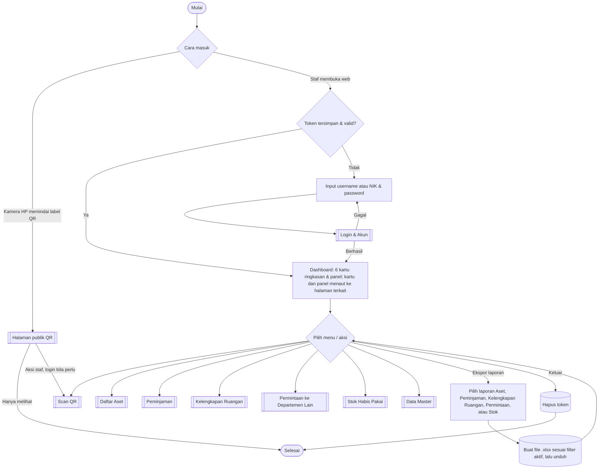

## 2. Daftar Aset

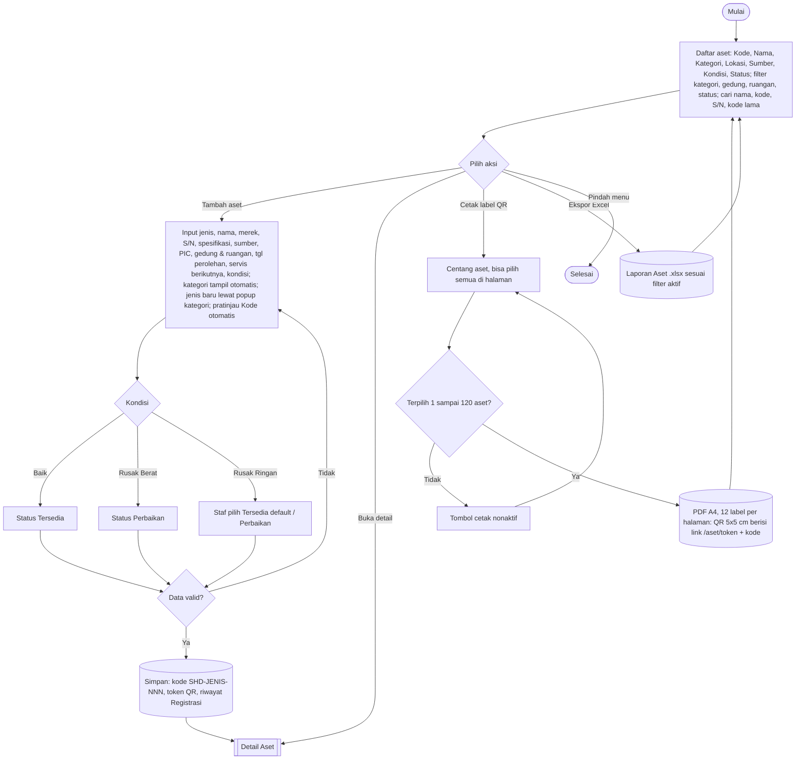

## 3. Detail Aset

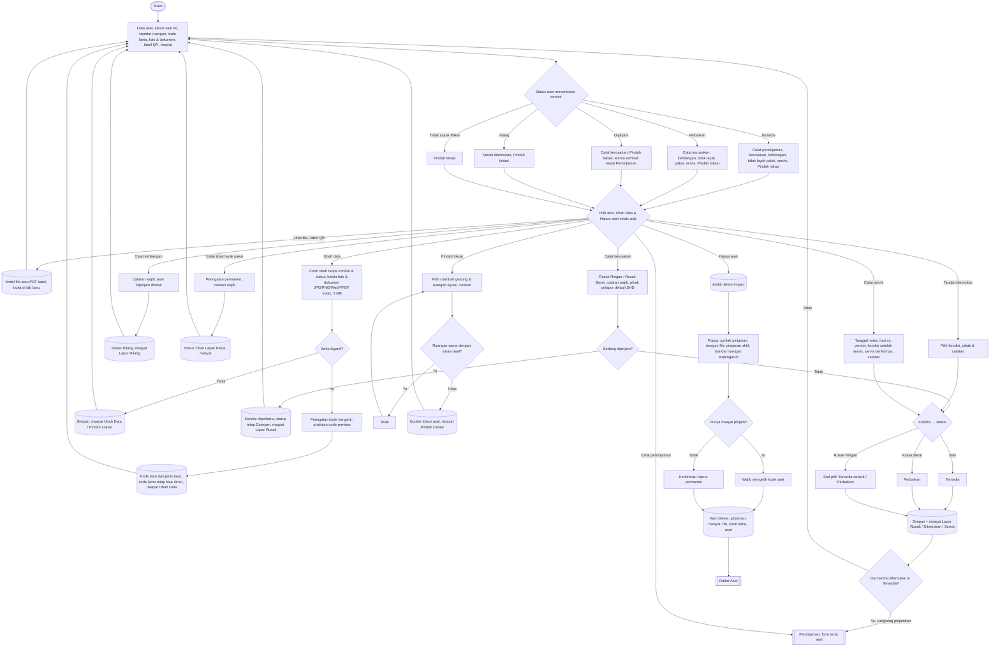

## 4. Scan QR

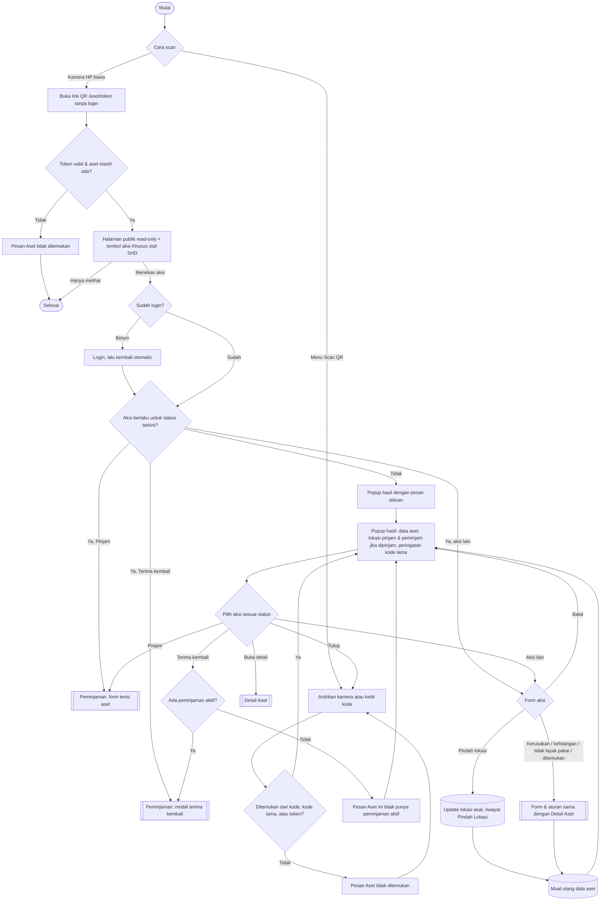

## 5. Peminjaman

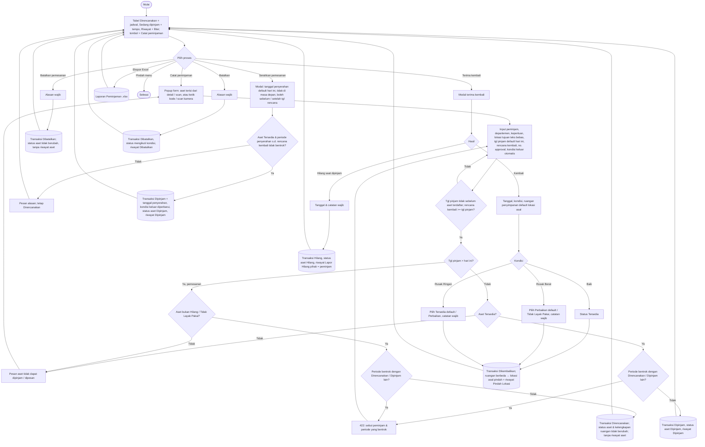

## 6. Kelengkapan Ruangan

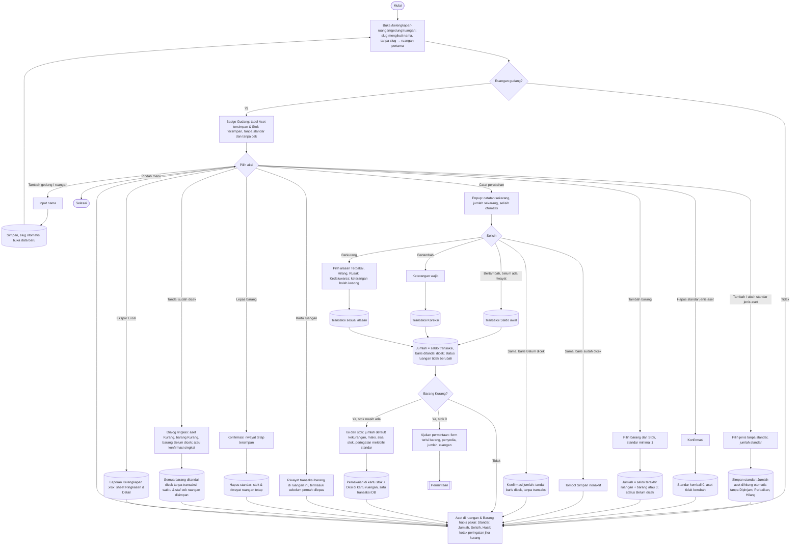

## 7. Permintaan ke Departemen Lain

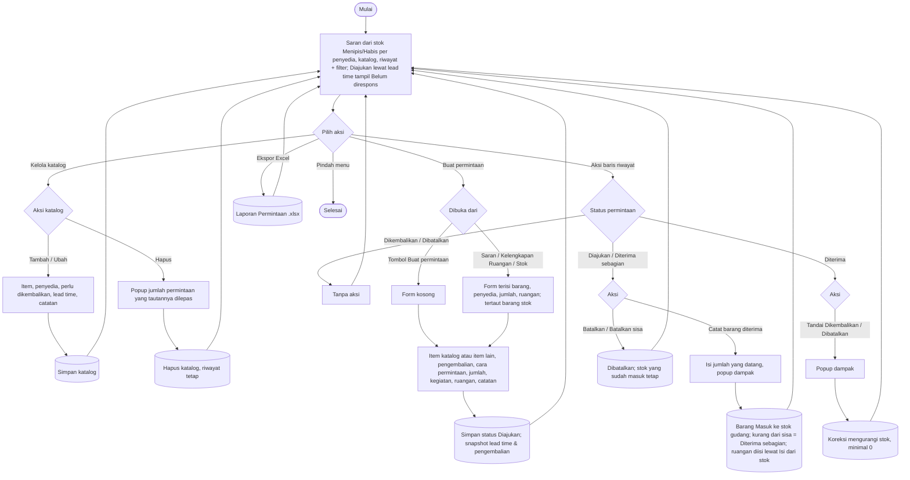

## 8. Stok Habis Pakai

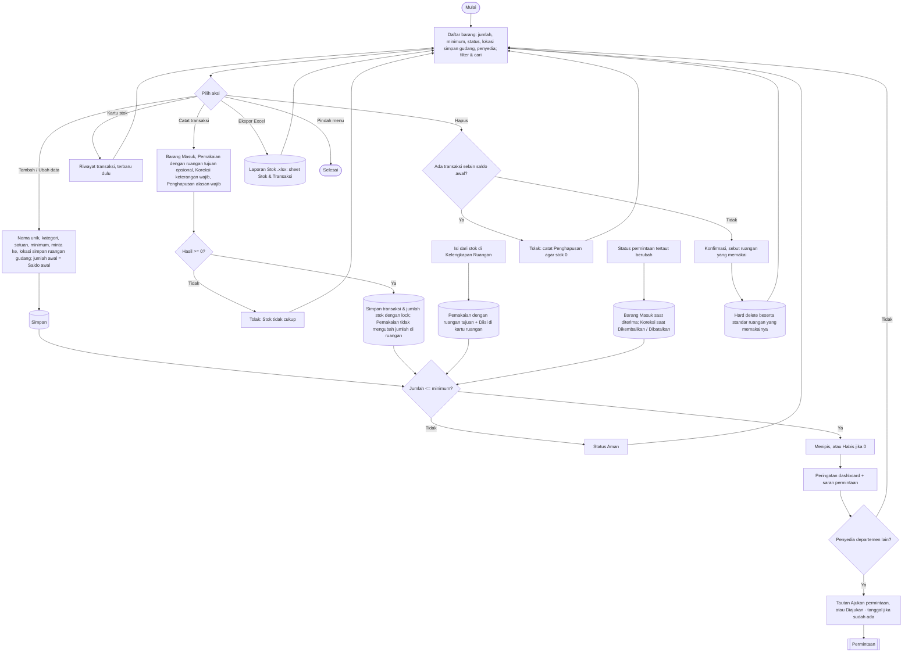

## 9. Data Master

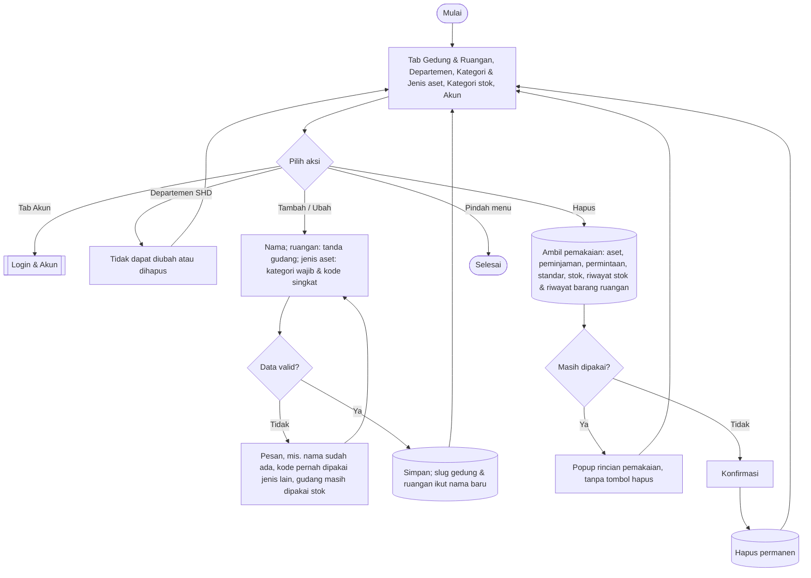

## 10. Login & Akun

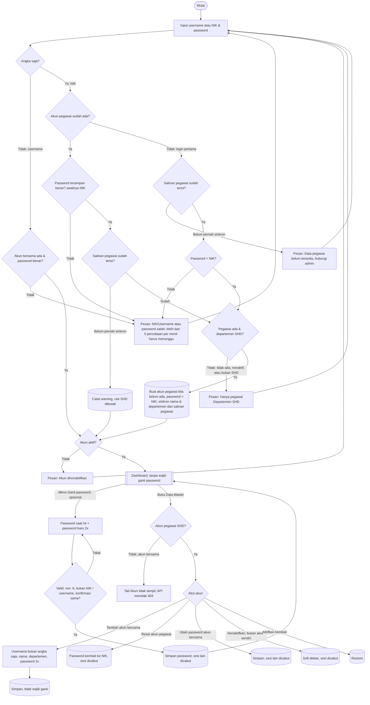

## 11. Sinkronisasi pegawai & departemen

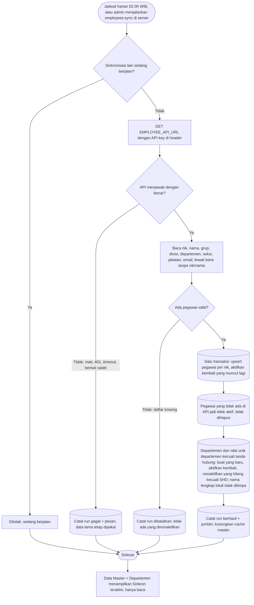
