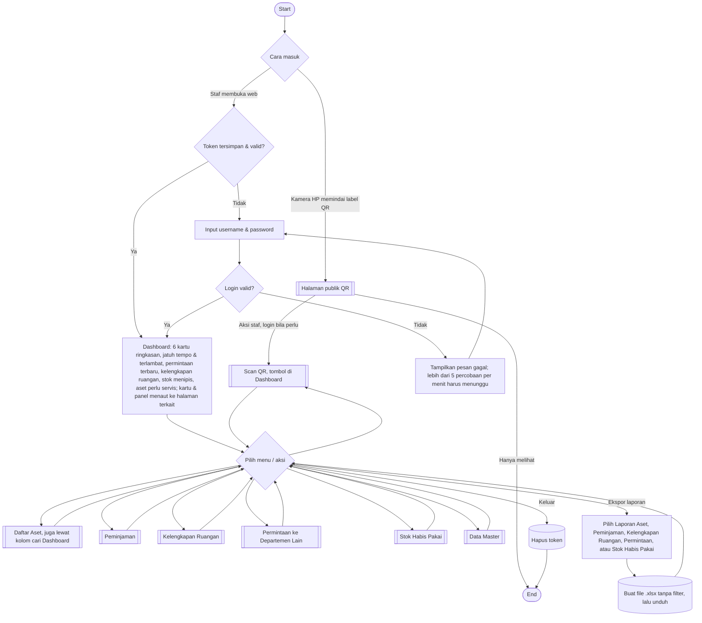
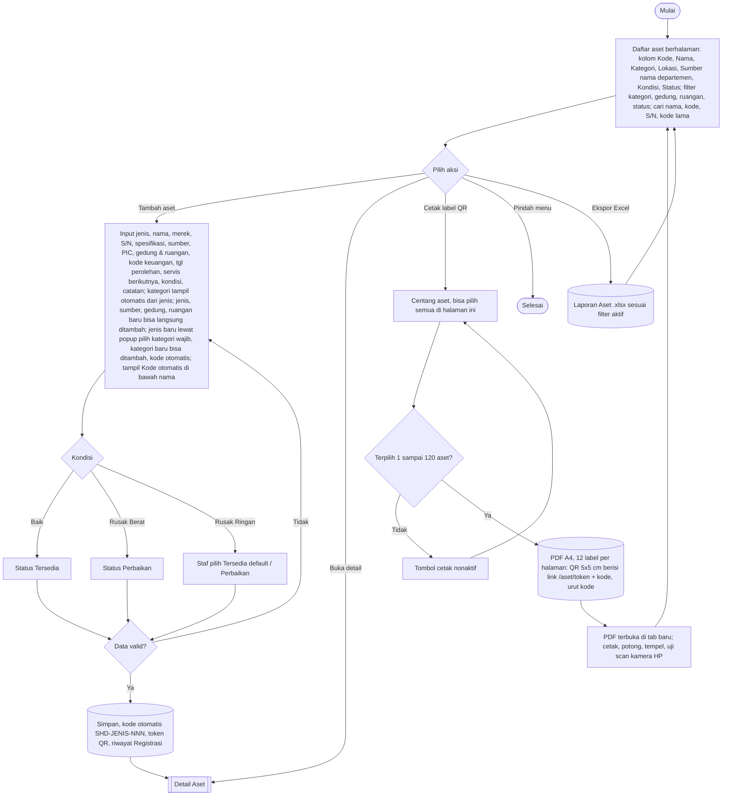
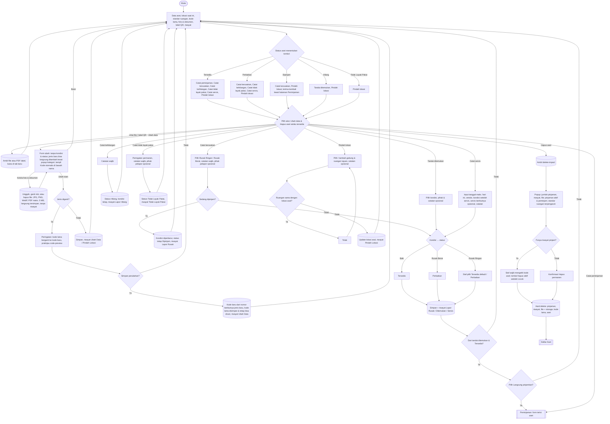
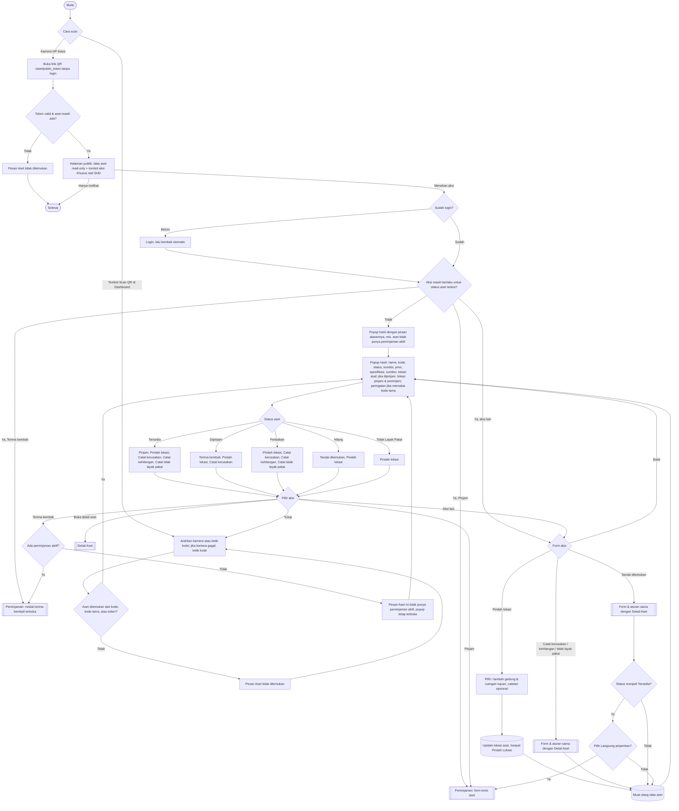
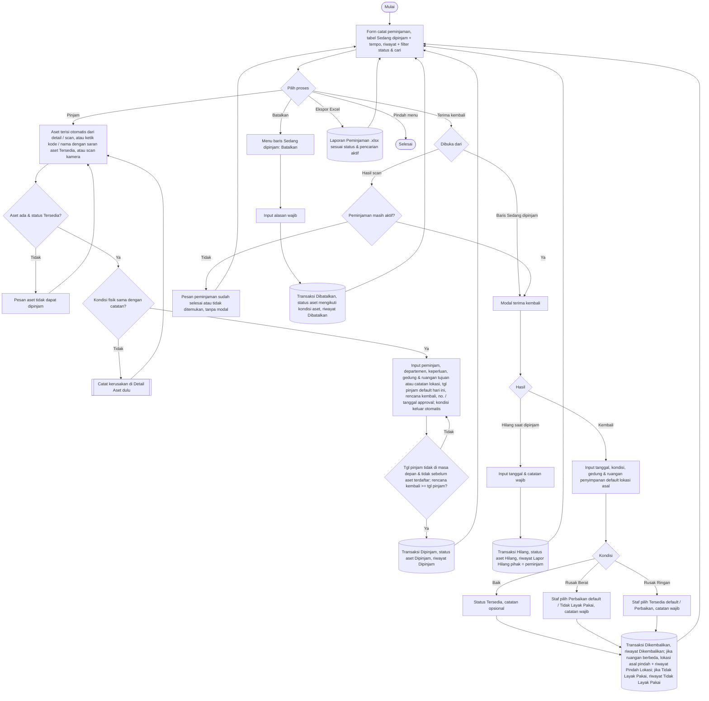
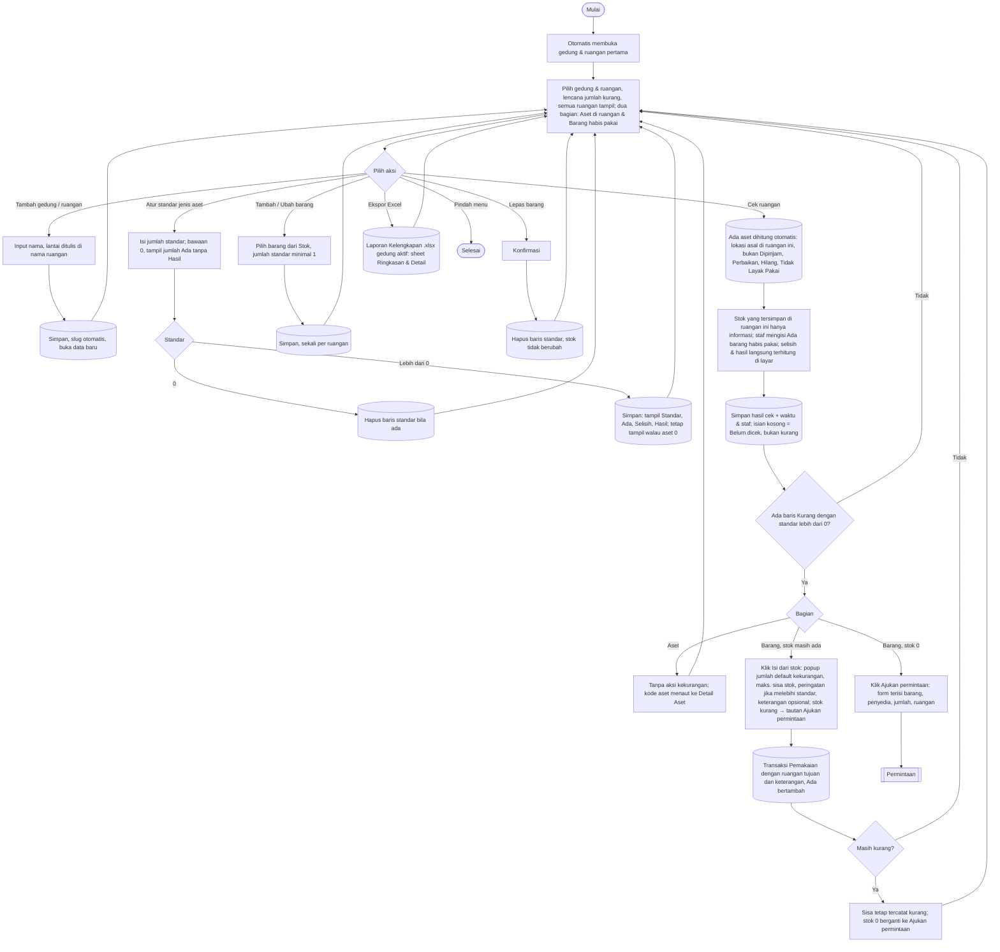
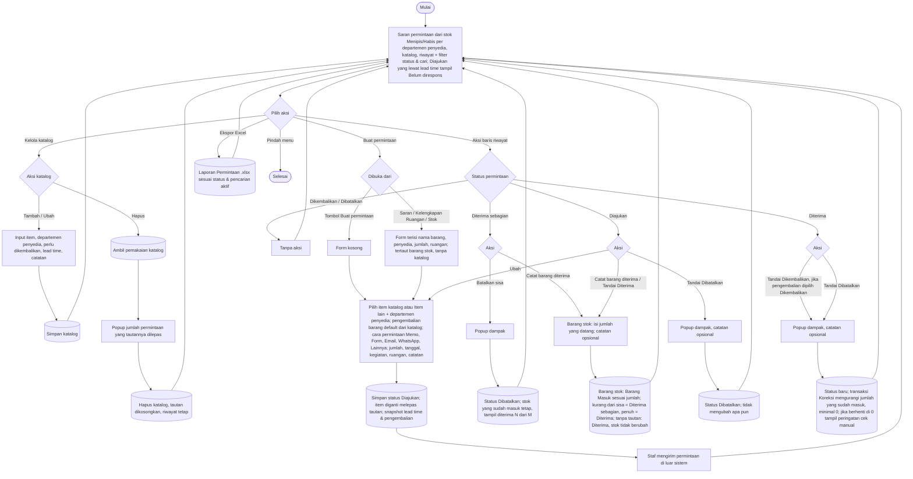
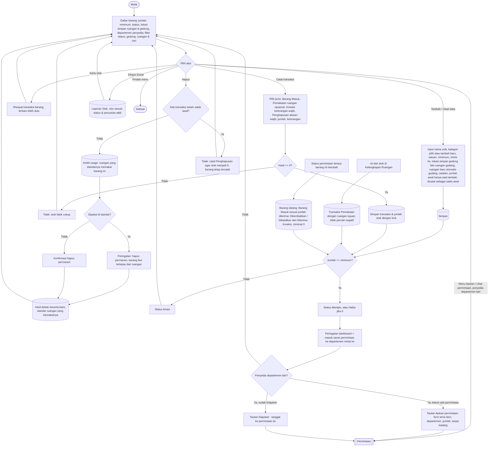
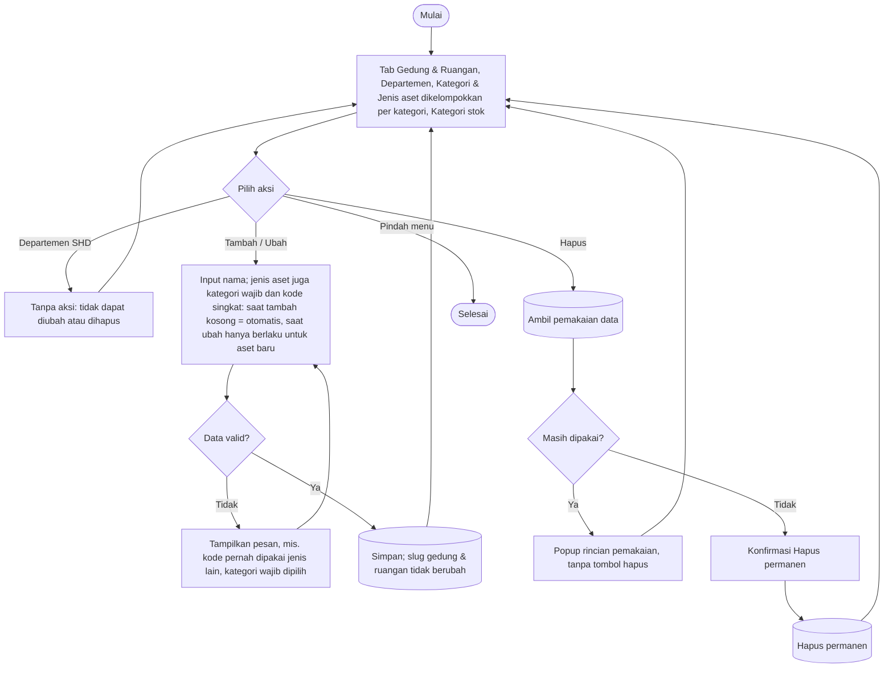

# Flowchart — Sistem Informasi Aset SHD

Disusun dari kode frontend & backend per 4 November 2026 (termasuk T26n).

Tempel tiap blok ke mermaid.live atau draw.io (Arrange → Insert → Advanced → Mermaid).

Simbol:
- Silinder `[( )]` = proses sistem/database.
- Kotak ganda `[[ ]]` = lanjut ke bagian lain.

## 1. Alur Utama

Menu Lisensi Digital tampil nonaktif di sidebar (Fase 2).

## 2. Daftar Aset

## 3. Detail Aset

## 4. Scan QR

## 5. Peminjaman

## 6. Kelengkapan Ruangan

## 7. Permintaan ke Departemen Lain

## 8. Stok Habis Pakai

## 9. Data Master

