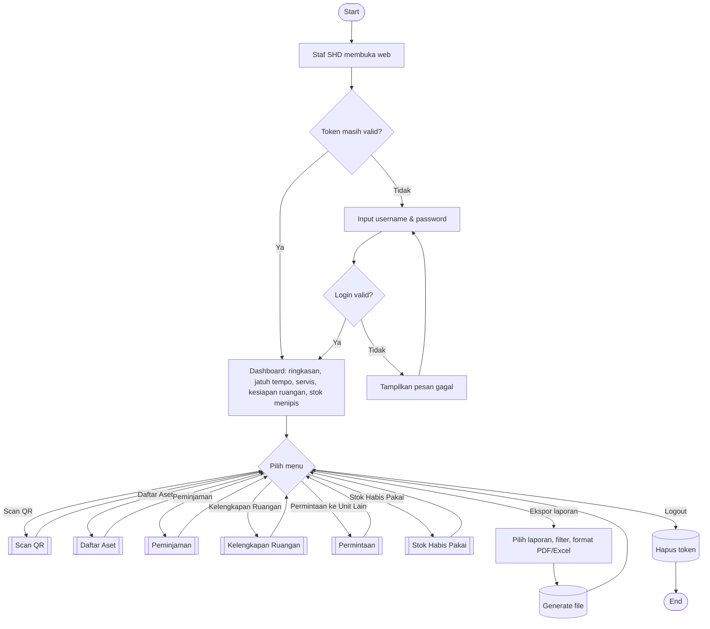
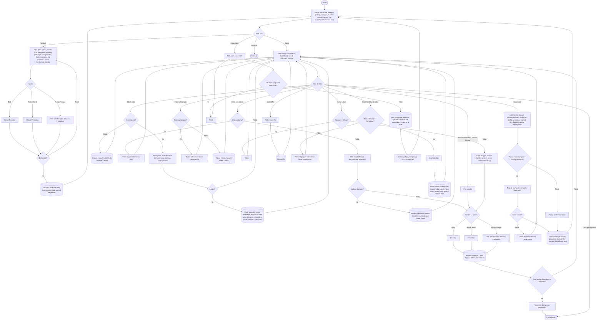
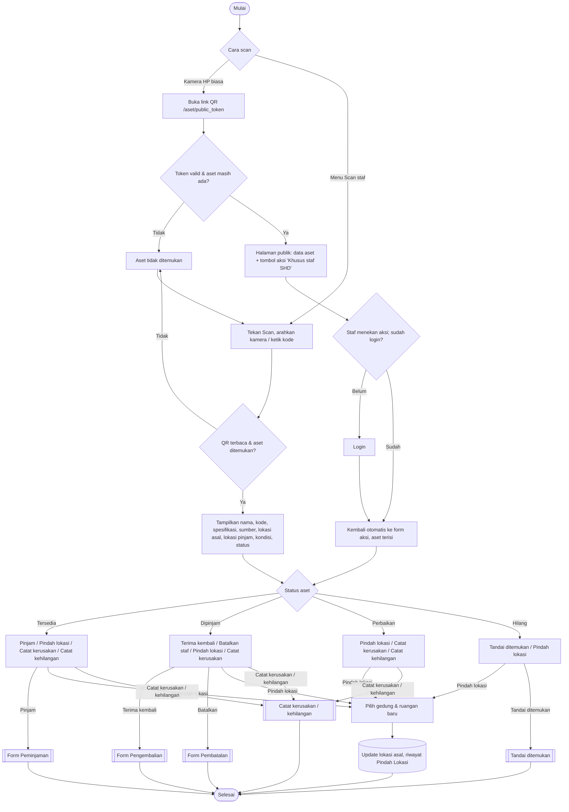
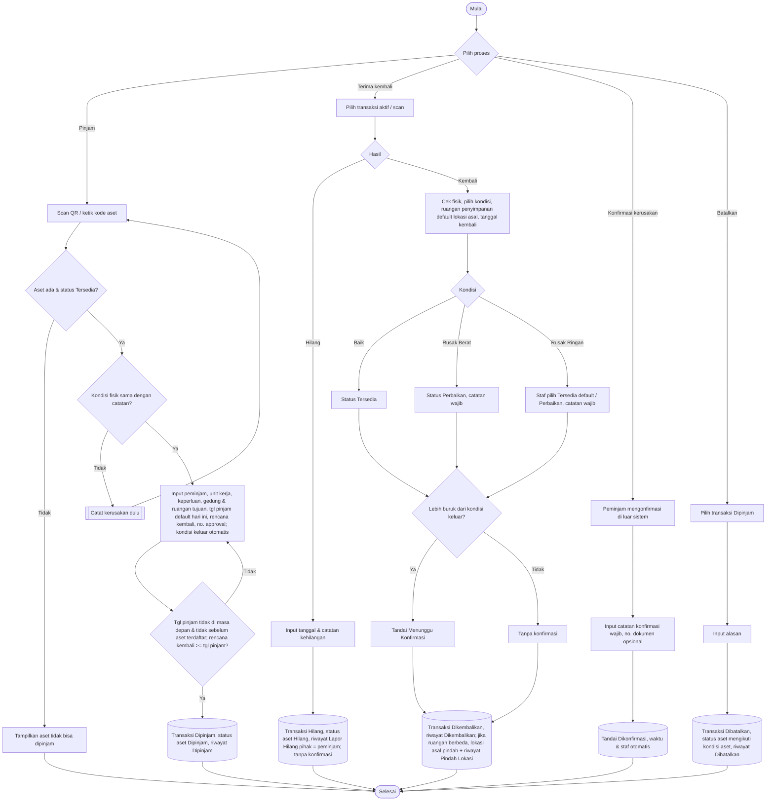
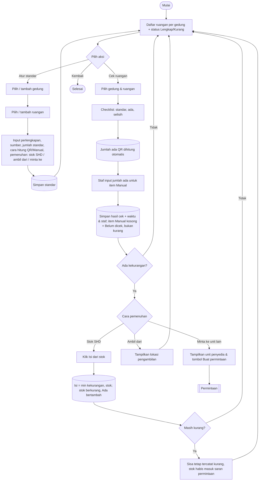
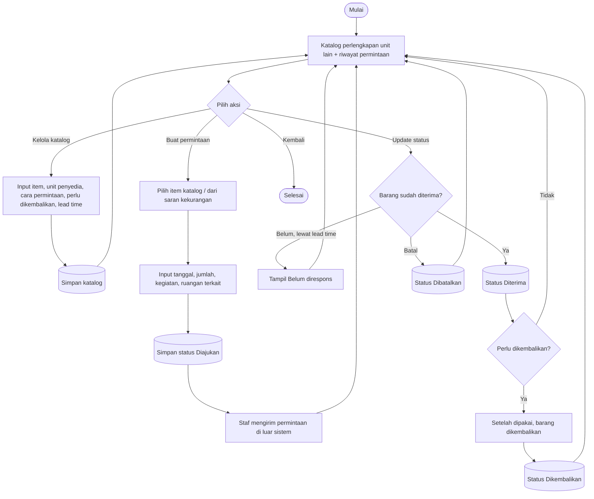
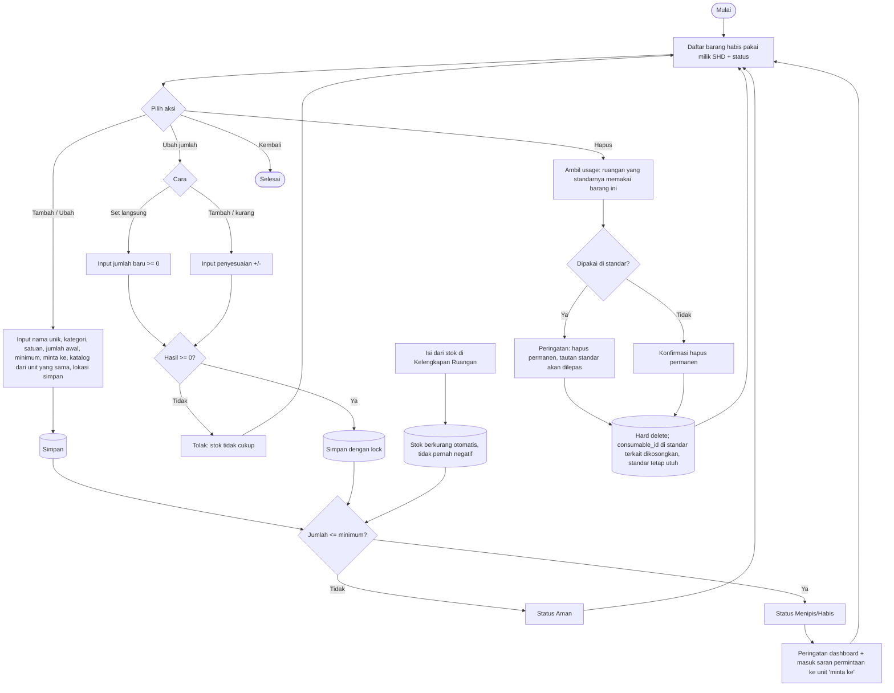

# Flowchart — Sistem Informasi Aset SHD

Tempel tiap blok ke mermaid.live atau draw.io (Arrange → Insert → Advanced → Mermaid).
Simbol silinder `[( )]` = proses sistem/database.

## 1. Alur Utama

## 2. Daftar Aset

## 3. Scan QR

## 4. Peminjaman

## 5. Kelengkapan Ruangan

## 6. Permintaan ke Unit Lain

## 7. Stok Habis Pakai

